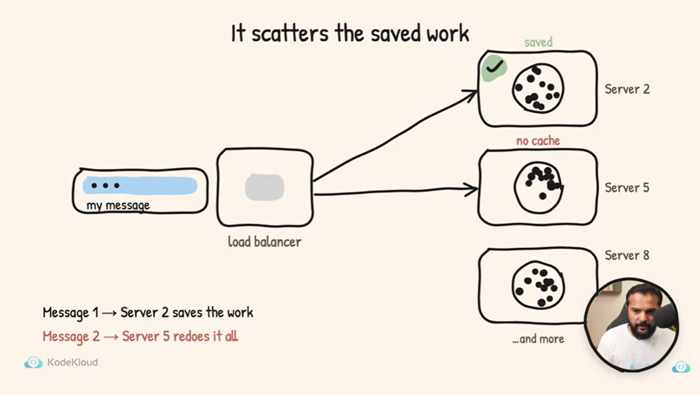

# Inference engine explanation in simple words

https://www.youtube.com/watch?v=hBzUokVYQkI

## Must read after finishing the Month 1. revist after completeion of month 2
### It will clear alot of concepts.
#### It covers:

-TTFT
-TPOT
-Prefill
-KV cache
-prefix cache
-Decode
-Batching
-model inference on Gpu via Vllm (Memory, bandwidth, computation)

## Main concept to remember:
#### Model can be split on multiple gpus. That can be in 
1. Single Machine Multiple Gpus: multiple gpus in single machine communction is done via NVlink-ultra fast
2. Model split in muliple gpus that resides on different machines: This concept is called sharding

#### Why load balancer is the wrong choice 

llm-d : A smart router that shit behind the fleet of model servers
A smart router watchs the queue, mempry left by each server and which request have already server so it manages each request state. 

